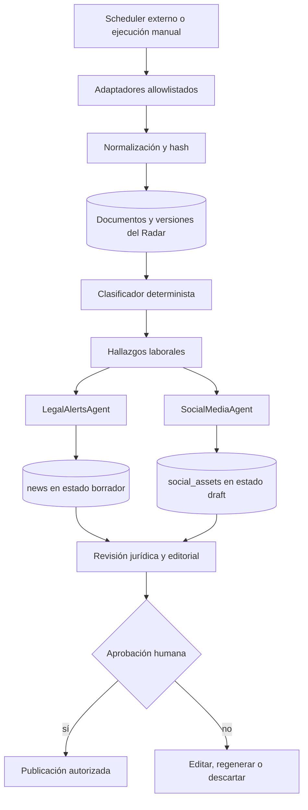

# Arquitectura propuesta — Radar Jurídico Laboral MX

## Principio

El Radar será un módulo de backend orientado a trazabilidad para todo México. Lee fuentes permitidas, normaliza metadatos, detecta novedades y entrega hallazgos a los agentes OpenAI existentes. El panel priorizará por defecto Nuevo León y permitirá filtrar por entidad, fuente, materia, fecha y nivel de impacto. Todo resultado editorial entra al CMS como borrador y requiere revisión humana.



## Capas

### 1. Adaptadores

Cada origen implementará el mismo contrato:

```ts
export type LegalSourceCode = 'DOF' | 'SJF' | 'STPS' | 'IMSS' | 'INFONAVIT' | 'PO_NL';

export interface LegalSourceAdapter {
  code: LegalSourceCode;
  listSince(input: { cursor?: string; from?: string; to?: string; limit: number }): Promise<{
    items: NormalizedLegalDocument[];
    nextCursor?: string;
    sourceStatus: 'success' | 'partial' | 'failed';
    errors: string[];
  }>;
  getById(externalId: string): Promise<NormalizedLegalDocument | null>;
}
```

El adaptador nunca recibe una URL libre. Cada host, protocolo, redirección, tamaño, timeout y tipo de respuesta se valida antes de descargar.

### 2. Normalización y deduplicación

El normalizador separa `publishedAt`, `effectiveAt`, `detectedAt` y `retrievedAt`. La clave primaria preferida es `(sourceCode, externalId)`. Cuando no exista un identificador confiable, se usa URL canónica más fingerprint del título y fecha. El cuerpo original se conserva sólo cuando las condiciones de la fuente lo permiten. Los resúmenes y copys se almacenan separados del texto de origen.

### 3. Clasificación

Antes de llamar al modelo se aplican reglas deterministas sobre autoridad, tipo de documento, materia, términos, fecha y jurisdicción. El agente evalúa relevancia e impacto sobre un conjunto ya reducido. Iniciativas, consultas y proyectos quedan diferenciados de leyes, decretos, acuerdos, tesis y jurisprudencia.

### 4. Agentes

- `legal_alerts` redacta el borrador web bilingüe y entrega evidencia.
- `social_media` adapta el hallazgo o el borrador aprobado a cada red.
- `content_analyzer` y `category_agent` completan revisión de clasificación y taxonomía.
- `seo_optimizer` propone metadatos.
- `polyglot_translator` traduce sólo después de contar con texto español aprobado.

Los agentes no publican, eliminan ni envían. La publicación sigue usando los endpoints y permisos existentes.

### 5. Revisión

La bandeja administrativa mostrará fuente, identificador, URL oficial, fechas, hash, temas, puntuaciones, estado de sincronización, borradores relacionados y decisiones del revisor. La edición manual de artículos y posts permanece disponible en las pantallas actuales.

## Tablas mínimas sugeridas

Se deben añadir mediante migración reversible, únicamente después de aprobar la fase de implementación:

```text
legal_sources
  id, code, name, base_url, terms_url, enabled, last_checked_at, config

legal_documents
  id, source_id, external_id, canonical_url, title, abstract, document_type,
  authority, subject, jurisdiction, epoch, thesis_type, digital_registry,
  publication_date, issue_date, effective_date, first_seen_at, retrieved_at,
  content_hash, raw_metadata, content_reference, status

legal_document_versions
  id, document_id, content_hash, retrieved_at, source_modified_at,
  change_type, metadata_snapshot, content_reference

monitor_runs
  id, job_name, source_id, started_at, finished_at, status, cursor_before,
  cursor_after, records_seen, records_new, records_changed, errors, retry_count

legal_findings
  id, document_id, topics, relevance_score, impact_score, confidence,
  reasoning_summary, evidence_refs, review_status, assigned_reviewer_id,
  reviewed_at

editorial_drafts
  id, finding_ids, news_id, social_asset_ids, content_types, source_citations,
  legal_review_status, editorial_status, created_by_agent_id, approved_by_user_id,
  published_at
```

Los documentos públicos finales deben seguir usando `news`, `newsTranslations`, `social_assets` y los permisos existentes. No se duplica el sistema de usuarios ni se crean tablas paralelas para artículos publicados.

## Herramientas de agente

Las acciones deben ser de lectura o creación de borradores:

```text
list_dof_issues({ date, edition? })
get_dof_note({ external_id })
search_scjn_theses({ query, subject?, epoch?, thesis_type?, published_from?, published_to?, limit? })
get_scjn_thesis({ digital_registry })
get_scjn_judgment({ identifier })
list_new_legal_findings({ since?, topic?, status?, limit? })
verify_official_reference({ source, external_id_or_url })
create_cms_draft({ finding_ids, content_types, template_id? })
```

Todas las respuestas deben incluir fuente, identificador, URL oficial, fechas de publicación y recuperación, hash cuando aplique, estado de verificación y estado de publicación.

## Jobs y fiabilidad

El runner debe usar `agentJobs` para análisis y generación, pero conservar `monitor_runs` para la sincronización de fuentes. Cada ejecución tendrá lock por `jobName + source`, cursor antes/después, límites, reintentos exponenciales y circuit breaker. La primera versión debe permitir ejecución manual y un endpoint administrativo controlado. La programación recurrente puede conectarse después a Replit Routines o a un scheduler externo en `America/Monterrey`.

## Seguridad

- Allowlist estricta de hosts oficiales, sin URLs proporcionadas por usuarios.
- Bloqueo de loopback, IP privadas, metadata endpoints y redirecciones fuera de la allowlist.
- Timeout, límite de bytes, límite de registros y sanitización de HTML.
- Fuente delimitada como datos no confiables para el agente.
- Cero secretos en prompts, logs o `raw_metadata`.
- Permisos separados para sincronizar, analizar, aprobar y publicar.
- No cargar expedientes, datos de clientes ni documentos confidenciales al radar público.

## Decisión de despliegue

No se debe ejecutar una carga histórica de cientos de miles de criterios dentro de Replit Web. `SCJN_SQLITE`, si se usa, debe funcionar como proceso batch aislado con checkpoint y después importar sólo metadatos normalizados. El frontend público no cambia en esta fase.
